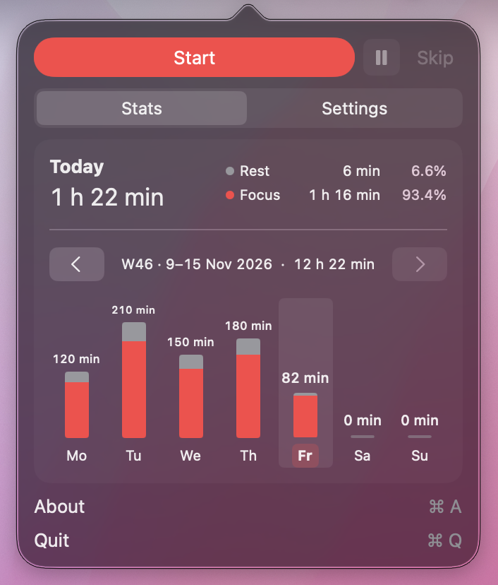
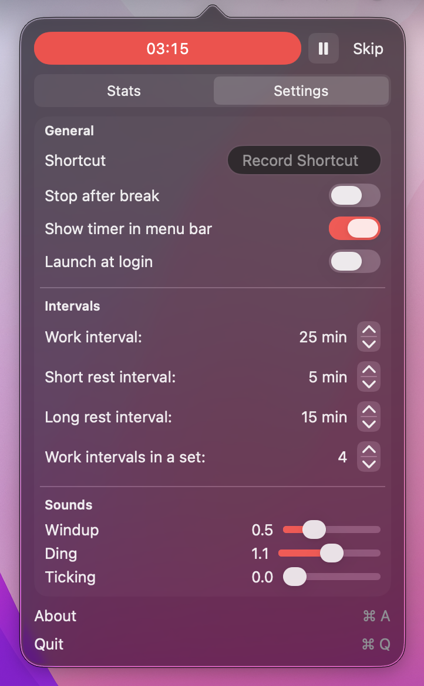

<p align="center">
  
</p>

<h1 align="center">TomatoBar-Stats</h1>

<p align="center">
  A macOS menu bar Pomodoro timer with daily and weekly statistics.
</p>

TomatoBar-Stats builds on [TomatoBar](https://github.com/ivoronin/TomatoBar) by Ilya Voronin. This fork adds a persistent activity history, visual summaries of focus and rest time, and pause and skip controls. Its UX and accessibility improvements are developed through iterative use and testing.

<table>
  <tr>
    <th>Daily and weekly statistics</th>
    <th>Timer settings</th>
  </tr>
  <tr>
    <td valign="top"></td>
    <td valign="top"></td>
  </tr>
</table>

The statistics screenshot includes sample activity data.

## Features

- **Daily and weekly statistics.** See your daily total, the focus/rest breakdown with percentages, and seven stacked bars for the week. Weeks run Monday through Sunday.
- **Explore your activity.** Hover over a day to preview it, click to keep it selected, and click it again to return to Today. Browse previous weeks with the arrow controls.
- **Flexible timer controls.** Pause either focus or rest and resume with the time remaining. Skip an interval to start the next one.
- **Persistent local history.** Record elapsed focus and rest time, including intervals stopped before completion.
- **A simpler settings panel.** General preferences, intervals and sounds are grouped under Settings.
- **Visible timer states.** The menu bar icon is red during focus, gray during rest and amber while paused.

The original configurable intervals, optional sounds, notifications, launch-at-login preference and global shortcut remain available.

## How time is counted

Total Pomodoro time includes both focus and rest. Paused time is excluded.

Statistics use completed activity segments saved in the log. A running segment contributes to the chart once it ends, is paused, skipped or stopped. Pausing closes the current segment; resuming starts another.

Segments crossing midnight are split between the two local days. Dates use the Mac's time zone. Displayed minutes are rounded consistently so the daily breakdowns and weekly total add up.

Opening Stats resets the view to Today and the current week. Selected days stay highlighted while other days can be previewed with the pointer.

## Build and run

The project uses Swift, SwiftUI and AppKit. Install full Xcode and complete its first-launch setup before building.

1. Clone this fork and open the project:

   ```bash
   git clone https://github.com/MarcRibera/TomatoBar-Stats.git
   cd TomatoBar-Stats
   open TomatoBar.xcodeproj
   ```

2. Select the **TomatoBar** scheme and **My Mac** as the destination.
3. Configure signing for your development environment if requested, then run the app.
4. Open the tomato icon in the menu bar to access Stats, Settings and the timer.

The app target declares macOS 11 or later. Explicit Stats keyboard focus handling uses macOS 14 APIs; keyboard behavior on earlier versions remains unverified.

A prepared public binary release is pending. The build product is currently named `TomatoBar.app`.

## Activity log

The app writes one JSON event per line to `Application Support/Pomodoro/TomatoBar.log` inside its sandbox container.

With the repository's default bundle identifier, the path is:

```text
~/Library/Containers/com.github.ivoronin.TomatoBar/Data/Library/Application Support/Pomodoro/TomatoBar.log
```

A custom bundle identifier uses a different container. The original app and this fork currently share the default identifier, so use a distinct identifier when configuring a separate development installation.

Events retain the numeric `timestamp` and include a readable `localTime` with its UTC offset. A save failure stops the timer and offers Retry or Quit.

Normal app termination and Mac sleep close active segments. Waking or reopening leaves the timer stopped. Recovery after crashes or abrupt power loss is outside the current scope.

The existing URL action is also supported:

```bash
open 'tomatobar://startStop'
```

## UX and accessibility

Stats opens first to make recent activity immediately available. The chart supports pointer previews and keyboard interaction. On macOS 14 or later, Tab and Shift+Tab move focus, Space selects a day, and a thin focus outline distinguishes keyboard focus from the selected day.

Accessibility testing is ongoing. Known follow-up work includes:

- Fixing Tab navigation through Settings controls.
- Verifying keyboard access to the top timer controls.
- Testing the interface with VoiceOver and checking contrast across accessibility settings.
- Verifying Stats keyboard behavior on macOS versions earlier than 14.

Statistics are currently displayed in English. Localization is planned for a later version.

## Tests

The suite covers event logging and recovery, history parsing, timer transitions, daily and weekly totals, date boundaries and day-selection behavior.

Run it from the repository root:

```bash
xcodebuild test \
  -project TomatoBar.xcodeproj \
  -scheme TomatoBar \
  -configuration Debug \
  -destination 'platform=macOS' \
  -derivedDataPath /tmp/TomatoBar-Stats-tests \
  CODE_SIGNING_ALLOWED=NO \
  -parallel-testing-enabled NO
```

The latest local validation passed 48 tests.

## Credits and license

Based on [TomatoBar](https://github.com/ivoronin/TomatoBar) by Ilya Voronin. Fork maintained by [Marc Ribera](https://github.com/MarcRibera).

Distributed under the [MIT license](LICENSE), retaining the original copyright notice. The original project credits buddhabeats for the timer sounds.
