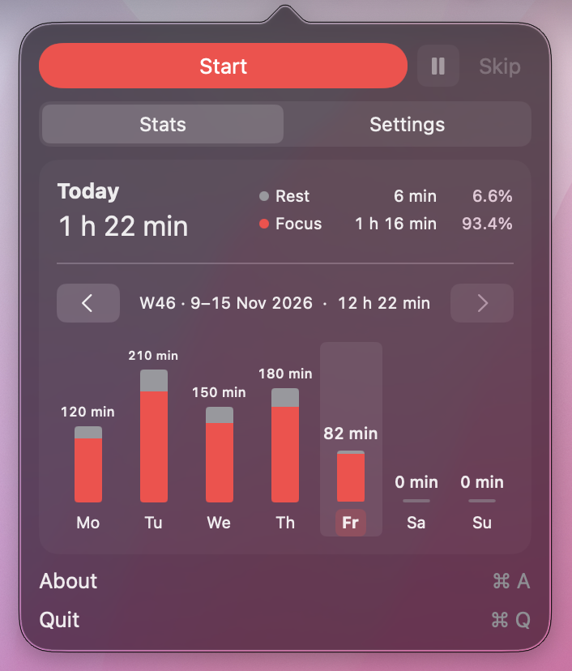
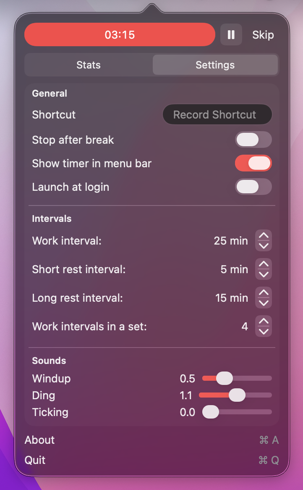

<p align="center">
  
</p>

<h1 align="center">TomatoBar-Stats</h1>

<p align="center">
  A macOS menu bar Pomodoro timer with daily and weekly statistics.
</p>

TomatoBar-Stats builds on [TomatoBar](https://github.com/ivoronin/TomatoBar) by Ilya Voronin. This fork adds a persistent activity history, visual summaries of focus and rest time, and pause and skip controls. Its UX and accessibility improvements are developed through iterative use and testing.

<table>
  <tr>
    <th>Daily and weekly statistics</th>
    <th>Timer settings</th>
  </tr>
  <tr>
    <td valign="top"></td>
    <td valign="top"></td>
  </tr>
</table>

The statistics screenshot includes sample activity data.

## Features

- 📊 **Daily and weekly statistics.** See your daily total, the focus/rest breakdown with percentages, and seven stacked bars for the week. Weeks run Monday through Sunday.
- 🔎 **Explore your activity.** Hover over a day to preview it, click to keep it selected, and click it again to return to Today. Browse previous weeks with the arrow controls.
- ⏯️ **Flexible timer controls.** Pause either focus or rest and resume with the time remaining. Skip an interval to start the next one.
- 💾 **Persistent local history.** Record elapsed focus and rest time, including intervals stopped before completion.
- ⚙️ **A simpler settings panel.** General preferences, intervals and sounds are grouped under Settings.
- 🍅 **Visible timer states.** The menu bar icon is red during focus, gray during rest and amber while paused.

The original configurable intervals, optional sounds, notifications, launch-at-login preference and global shortcut remain available.

## Build and run

The project uses Swift, SwiftUI and AppKit. Install full Xcode and complete its first-launch setup before building.

1. Clone this fork and open the project:

   ```bash
   git clone https://github.com/MarcRibera/TomatoBar-Stats.git
   cd TomatoBar-Stats
   open TomatoBar.xcodeproj
   ```

2. Select the **TomatoBar** scheme and **My Mac** as the destination.
3. Configure signing for your development environment if requested, then run the app.
4. Open the tomato icon in the menu bar to access Stats, Settings and the timer.

The app target declares macOS 11 or later. Explicit Stats keyboard focus handling uses macOS 14 APIs; keyboard behavior on earlier versions remains unverified.

A prepared public binary release is pending. The build product is named `TomatoBar-Stats.app`.

## Activity log

The app keeps a local history of focus and rest periods, which provides the data for the daily and weekly statistics. Events are saved as one JSON object per line, with a timestamp and a readable local time.

The log is stored in:

```text
~/Library/Containers/com.github.marcribera.TomatoBarStats/Data/Library/Application Support/Pomodoro/TomatoBar.log
```

## Tests

The suite covers event logging and recovery, history parsing, timer transitions, daily and weekly totals, date boundaries and day-selection behavior.

Run it from the repository root:

```bash
xcodebuild test \
  -project TomatoBar.xcodeproj \
  -scheme TomatoBar \
  -configuration Debug \
  -destination 'platform=macOS' \
  -derivedDataPath /tmp/TomatoBar-Stats-tests \
  CODE_SIGNING_ALLOWED=NO \
  -parallel-testing-enabled NO
```

The latest local validation passed 49 tests, including URL scheme isolation.

## Credits and license

Based on [TomatoBar](https://github.com/ivoronin/TomatoBar) by Ilya Voronin. Fork maintained by [Marc Ribera](https://github.com/MarcRibera).

Distributed under the [MIT license](LICENSE), retaining the original copyright notice. The original project credits buddhabeats for the timer sounds.
